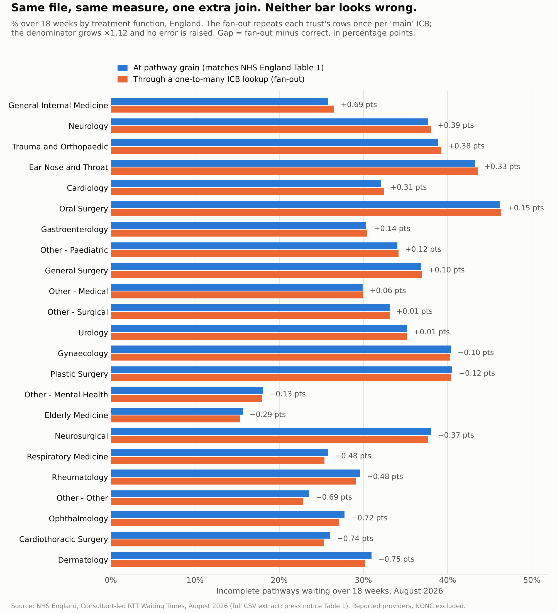

# The join you never documented: a fan-out on NHS RTT data

A worked demonstration, on real August 2026 figures, of how a single
one-to-many join quietly changes NHS waiting-list figures without raising an
error. Python (pandas), SQL (DuckDB, portable to MySQL 8), Parquet, Jupyter.

I compute the percentage of incomplete RTT pathways waiting over 18 weeks,
by treatment function, twice: once at the correct grain, which I first prove
matches NHS England's published figures exactly, and once through a join to
a provider → "main ICB" lookup that holds more than one row for some trusts.

**Status: reconciliation gate PASSES (53 of 53 checks). Notebooks 00–04 built.**



## What I found

| | At pathway grain | Through the fan-out |
|---|---|---|
| Rows returned | 501,422 (each pathway once) | 564,592 (rows × main ICBs per trust) |
| Denominator (England pathways) | 7,158,164 | 8,051,914 (×1.12) |
| England % over 18 weeks | 34.8% | 34.7% |
| Specialties moved 0.5+ points | — | 5 of 23 |
| Largest move | — | Dermatology −0.75 pts |
| Providers silently dropped | 0 | 2 (16,483 pathways) |
| Error raised | — | None |
| Looks plausible | Yes | Yes |

* **The rate barely moves, which is why it survives.** Across the 23 treatment
  functions the gap runs from −0.75 to +0.69 percentage points, and 6 of them
  swap places in the league table. The England rate moves by 0.1 of a point.
* **It isn't "the denominator doubles".** A fan-out that repeated every row
  equally wouldn't move a rate at all, because numerator and denominator
  scale together. It moves the rate only because it repeats *some* trusts'
  rows, re-weighting the average towards them (notebook 03 shows the
  fan-out rate is exactly that re-weighting). The direction depends on which
  trusts are repeated, so it can't be eyeballed.
* **No single-trust figure catches it.** Joined on `provider_code`, every
  provider × treatment function rate is identical through the fan-out
  (3,502 checked). Only the counts and the totals across trusts change.
* **The size of the error depends on an arbitrary threshold.** At 20% the
  largest gap is 0.75 points; at 10% it is 4.0 points and 10 specialties move
  by 0.5+ (`threshold_sensitivity.csv`). 20% is the gentlest of the
  thresholds I tried.
* **The crude version gets caught.** A lookup of *every* ICB a trust serves
  inflates England to 240 million pathways (×34). Nobody presents that. The
  dangerous fan-out is the modest one.
* **The merger version is too small to carry the argument.** The only trust
  merger in the window (North Bristol into Bristol NHS FT, July 2026) gives a
  ×1.013 inflation and a largest gap of 0.33 points.

Full numbers: [`findings.md`](findings.md).

## SQL version

Most people who'll meet this bug meet it in SQL, so
[`sql/fan_out.sql`](sql/fan_out.sql) has the same two queries: the
correct-grain query, then the same query with
`JOIN ref_provider_main_icb USING (provider_code)` added. It also builds the
lookup and lays the gaps out side by side. The queries are plain enough to
run unchanged in MySQL 8; only a short preamble that gives the Parquet files
table names is DuckDB-specific. `sql/run_sql.py` runs the file in DuckDB and
asserts every figure equals the pandas output (pathways exact, percentages to
1e-9), writing results to `data/gold/03_sql/`.

The check that catches it takes a second, and I'd run it on any lookup before
joining it to a fact table:

```sql
-- 1. If these differ, the key isn't unique and the join will fan out.
SELECT COUNT(*), COUNT(DISTINCT provider_code) FROM ref_provider_main_icb;  -- 621 vs 530

-- 2. Which keys repeat.
SELECT provider_code, COUNT(*) FROM ref_provider_main_icb
GROUP BY provider_code HAVING COUNT(*) > 1;                                   -- 87 trusts

-- 3. Which providers an inner join would drop.
SELECT p.provider_code FROM dim_provider p
LEFT JOIN ref_provider_main_icb r ON r.provider_code = p.provider_code
WHERE r.provider_code IS NULL;                                                -- 2 trusts
```

## The checks, packaged: join-guard

This repo shows the problem on one month of NHS data. To check my own joins
from now on, I turned the checks into a small, tested package:
**[join-guard](https://github.com/YusufIsmailayo/join-guard)**. It checks a
lookup before you join it: are its keys unique, which rows would an inner join
drop, are there null keys, and what would the join do to a total. It does this
in pandas (`guarded_merge` refuses the join and says why) and as portable
SQL. Its test suite uses this repo's August 2026 case, so it has to catch the
same 87 repeated trusts, 2 dropped providers and 7,158,164 → 8,051,914
inflation reported here.

## The limitation: declared is not validated

A declared cardinality records intent; it doesn't read the data. Databricks'
metric-view relationship constraint (`ALTER VIEW … ADD CONSTRAINT …
RELATIONSHIP`, Beta) is documented as metadata that Databricks doesn't
enforce or check against the data. Notebook 03 declares the lookup
many-to-one, the way the analyst in the scenario believed it was, and then
checks it separately: the data has up to 3 rows per trust and 2 trusts with
none. A wrong declaration is a confidently wrong declaration. What stopped the
fan-out in my own code was a *check* (`merge(..., validate="many_to_one")`),
not a declaration.

## Run order

```
pip install -r requirements.txt
cd notebooks
jupyter nbconvert --to notebook --execute --inplace 00_bronze.ipynb 01_star_schema.ipynb 02_reconciliation_gate.ipynb 03_fan_out.ipynb 04_charts.ipynb 05_article_images.ipynb
cd ..
python sql/run_sql.py
```

`02_reconciliation_gate.ipynb` raises on any failed check, and `03_fan_out`
refuses to run unless the gate's 53 checks all passed.

| Notebook | Layer | What it does |
|---|---|---|
| `00_bronze` | Bronze | downloads the three NHS England files unmodified, records SHA-256 in `data/bronze/*/metadata.json` |
| `01_star_schema` | Silver | fact table at period × provider × commissioner × treatment function × week band, four dimensions, every join asserted many-to-one |
| `02_reconciliation_gate` | Gold 00 | **T**: press notice Table 1, all 23 treatment functions, pathways exact and % within 18 weeks to 1 d.p.; **P**: the Incomplete Provider workbook, every provider × treatment function × week band exact |
| `03_fan_out` | Gold 01 | the "main ICB" lookup, the fan-out, the gap by treatment function, the explanatory table, the crude contrast, threshold sensitivity, rank changes, the merger version, declared vs validated |
| `04_charts` | Gold 02 | the paired bar chart, the explanatory table as an image, alt text generated from the same numbers |
| `05_article_images` | Gold 02 | the chart redrawn for Medium's column width (`paired_bars_fan_out_medium.png`) plus the cover (`cover_landscape.png`, 1800×945) and social card (`social_square.png`, 1260×1260) in the design of my other Medium cards, drawn by `src/make_cover_card.py`; alt text for all |
| `sql/run_sql.py` | Gold 03 | runs `sql/fan_out.sql` in DuckDB over the star and asserts it reproduces notebooks 02 and 03; raises on any mismatch |

## The measure

The same measure as my [August 2026 verification](https://github.com/YusufIsmailayo/nhs-rtt-august-2026-verification)
and Two Maps pieces: **reported-provider** incomplete pathways, `NONC`
(no identified commissioner) rows excluded, within 18 weeks = weekly bands
with upper bound ≤ 18. That is the basis of press notice Table 1 ("not
including estimates for missing trusts"), so the per-specialty figures can
be gated exactly. NHS England's headline England figure adds estimates for
non-submitting trusts and isn't split by treatment function.

"Pathway grain" here means every pathway is counted in exactly one fact row.
NHS England doesn't publish one row per pathway; the public extract is
already aggregated.

## Sources

NHS England, Consultant-led Referral to Treatment Waiting Times, August 2026
(published 8 October 2026): the full CSV extract, the statistical press
notice and the Incomplete Provider workbook. URLs in `src/sources.py`,
hashes in `data/bronze/*/metadata.json`. Crown copyright, Open Government
Licence v3.
